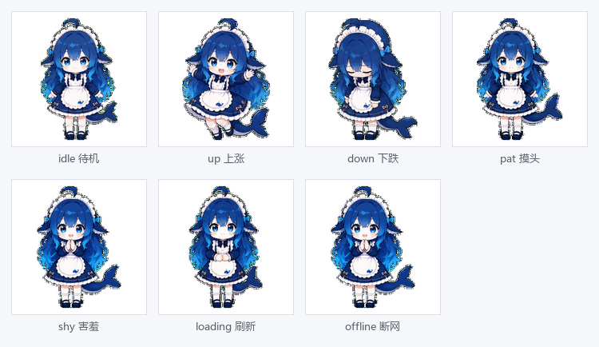

# 🐥 黄金桌宠（Gold Pet）

一只住在桌面右下角的「金娘」——**鲸鱼女仆**（v0.6.0 起采用社区同人 DeepSeek 鲸鱼娘形象），**实时盯着金价**：涨了笑、跌了哭，点一下切换 国内元/克 ↔ 国际美元/盎司。



> 平台支持：**Windows 首选**（提供免安装 exe），**macOS / Linux 亦支持**（源码运行，见下方说明）。
> Android / 鸿蒙 HAP 见 [docs/PRD.md](docs/PRD.md) 的二期、三期规划。

## 下载安装

| 平台 | 方式 | 说明 |
|---|---|---|
| **Windows 10/11 64位** | [⬇️ 下载 GoldPet-v0.6.0-win64.exe](https://cnb.cool/TJ-coding/gold-pet/-/releases/download/v0.6.0/GoldPet-v0.6.0-win64.exe) | 免安装绿色版，**双击即用**，无需装 Python |
| **macOS** | [从源码运行](docs/从源码运行.md) | 需先装 Python 3.11+，约 5 分钟 |
| **Linux** | [从源码运行](docs/从源码运行.md) | 需先装 Python 3.11+，约 5 分钟 |

> 全部版本见 [Releases](https://cnb.cool/TJ-coding/gold-pet/-/releases)。
> 校验文件：`GoldPet-v0.6.0-win64.exe.sha256`。

### 喜欢哪个形象，就下哪个版本

桌宠形象经历了多次更换，每个 Release 的 exe 都完整保留着**当时的形象**，
旧版随时可下载，不会丢：

| 形象 | 对应版本 | 直链 |
|---|---|---|
| 🐋 **DeepSeek 鲸鱼娘**（蓝发女仆，画师素材） | v0.6.0（当前） | [下载](https://cnb.cool/TJ-coding/gold-pet/-/releases/download/v0.6.0/GoldPet-v0.6.0-win64.exe) |
| 🥇 **金色鲸鱼女仆**（PIL 自绘，金主色） | v0.5.5 ~ v0.5.6 | [v0.5.5](https://cnb.cool/TJ-coding/gold-pet/-/releases/download/v0.5.5/GoldPet-v0.5.5-win64.exe) · [v0.5.6](https://cnb.cool/TJ-coding/gold-pet/-/releases/download/v0.5.6/GoldPet-v0.5.6-win64.exe)（含提醒修复，推荐） |
| 🐥 早期自绘少女 | v0.4.1 ~ v0.5.4 | 见 [Releases](https://cnb.cool/TJ-coding/gold-pet/-/releases) |

> 从源码运行的用户：两版图标已归档在 `assets/icons/`，
> `python tools/switch_icon.py v055` / `v060` 一键切换（详见该脚本说明）。

### 第一次打开怎么用？

双击 exe 后，金娘会出现在**桌面右下角**，并弹出一个引导窗口，问你
「要不要把金娘放到桌面和开始菜单？」——点「好呀」即可。

> **为什么需要这一步？** 金娘是桌宠，**不显示在任务栏**（免得占位）。
> 如果不创建快捷方式，关掉窗口后就没地方点了。创建之后，
> 桌面和开始菜单里都有「黄金桌宠」，随时双击就能叫出来。

如果当时点了「暂时不用」，之后可以随时补建：

- **右键金娘** → 「创建桌面快捷方式」
- 或 **右键金娘 → 设置…** → 勾选「桌面快捷方式」「开始菜单快捷方式」

## 运行配置要求

一只桌宠不该成为电脑负担。下表为**实机实测**数据（Windows 11 + Python 3.13，
测量脚本 [`tools/diag_resources.py`](tools/diag_resources.py)，可自行复跑）。

### 推荐配置

| 项目 | 最低 | 推荐 | 说明 |
|---|---|---|---|
| 操作系统 | Windows 10 1809 x64 | Windows 10/11 x64 | macOS 11+ / 主流 Linux 亦可（源码运行） |
| CPU | 双核 1.6 GHz | 四核 2.0 GHz+ | 桌宠仅在刷新与动画时占用极短 CPU 时间 |
| 内存 | 2 GB | 4 GB+ | 程序自身约 130 MB，见下表 |
| 磁盘 | 200 MB 可用 | 300 MB 可用 | exe 44.2 MB + 解压临时空间 |
| 显卡 | 支持 DX11 的集显 | 任意 | 仅 2D 绘制，**无 3D 需求** |
| 屏幕 | 1024×768 | 1280×720 以上 | 桌宠窗口约 176×239 px，需能容纳 |
| 网络 | 宽带（可断网） | 任意 | 仅需访问新浪财经公开接口，**断网自动降级** |

> **无 Python 要求**：Windows 免安装版已内置运行时，双击即用。
> macOS / Linux 源码运行需 Python 3.11+（见下方说明）。

### 资源占用（实测）

| 指标 | 实测值 | 备注 |
|---|---|---|
| 磁盘占用 | **44.2 MB** | 单文件 exe，无需安装 |
| 内存占用 | **约 130 MB** | 免安装版含内嵌 Python + Qt 运行时 |
| 内存增长 | **0 MB / 小时** | 连续动画 60 帧 + 重绘 30 次后增量 `+0.0 MB`，无泄漏 |
| 启动耗时 | **约 0.8 秒** | 源码运行；免安装版首次启动需解压，约 2–3 秒 |
| CPU（空闲） | **接近 0%** | 仅在刷新（默认 60 秒/次）与帧切换时短暂上升 |
| 网络流量 | **约 60 KB / 小时** | 默认 60 秒刷新一次，单次请求 < 1 KB |
| 窗口尺寸 | **176 × 239 px** | 气泡与走势图可分别在设置里关闭以缩小占位 |

> 内存 130 MB 主要来自 Qt（PySide6）运行时，属该技术栈正常水平；
> 若希望更轻量，可在设置中关闭走势图与气泡，并调大刷新间隔到 900 秒。

### 不推荐 / 已知限制

- **不支持 Windows 7 / 8**：PySide6 官方仅提供 Win10 1809+ 运行时，且需 x64。
- **不支持 32 位系统**：未提供 x86 构建。
- **Wayland 桌面**（部分 Linux）：建议 `QT_QPA_PLATFORM=xcb` 运行，详见跨平台文档。
- **远程桌面 / 虚拟机**：透明无边框窗口在部分 RDP 会话下可能不显示，属系统合成器限制。

### Windows 首次运行提示

1. 可能弹出蓝色窗口「**已保护你的电脑**」——程序未做代码签名。点 **更多信息 → 仍要运行**。
2. 部分杀毒软件可能误报，这是 PyInstaller 打包的通配现象，可加信任目录。
3. 程序**不显示在任务栏**（桌宠设计如此），请在**系统托盘**（时钟旁 `^` 展开区）找到它。
4. **关掉窗口 ≠ 退出程序**，金娘会回到托盘继续盯金价；
   想彻底退出请用右键菜单 →「退出」。
5. 右键金娘可打开菜单：刷新 / 切换单位 / 切换品种 / 提醒历史 / 设置 /
   创建桌面快捷方式。

## 功能

| 功能 | 说明 |
|---|---|
| 🪙 桌宠窗口 | 无边框、透明背景、置顶、可拖动、位置记忆 |
| 🎞️ 状态动画 | 待机（呼吸+眨眼）/ 涨（笑）/ 跌（哭）/ 加载中 / 离线 |
| 💬 价格气泡 | 国内金价 元/克 + 涨跌额与涨跌幅 + 更新时间 |
| 🔄 自动刷新 | 默认 60 秒，可选 15/30/60/300/900 秒；双击立即刷新 |
| 🔔 状态变化提醒 | 只有「状态真的变了」才弹：涨跌幅跨入更高档位、新高新低刷新水位、金价进出目标价。**价格横盘时不会重复弹窗** |
| 🪙 多品种 | 黄金 / 白银 / 铂金 一键切换（右键菜单或托盘） |
| 📈 迷你走势图 | 气泡下方实时折线，记录最近 120 个价格点 |
| 🗣️ 互动台词 | 到价提醒、手动点击时金娘会说话（4 秒后恢复价格） |
| 🖱️ 交互 | 单击切换单位 · 双击刷新 · 拖动移动 · 右键菜单 |
| 📌 托盘常驻 | 关窗=藏到托盘；托盘菜单可刷新/切换/设置/退出 |
| ⚙️ 设置 | 单位、刷新间隔、提醒阈值、不透明度、置顶、开机自启 |
| 🔌 离线兜底 | 断网显示「离线」+ 上次价格，不崩溃 |

## 快速开始（Windows 源码运行）

```bat
:: 1. 安装依赖（只需一次）
pip install -r requirements.txt

:: 2. 运行（双击 run.bat 或 run.py 都行）
python run.py
```

打包成单个 exe：

```bat
build.bat
:: 产物：dist\黄金桌宠.exe
```

## macOS / Linux 从源码运行

本项目基于 PySide6，**同一套代码在三大平台均可运行**，只是未提供 macOS / Linux 的预编译包。

完整步骤（含系统依赖、常见报错、打包方法）见 **[docs/从源码运行.md](docs/从源码运行.md)**。

三步速览：

```bash
python3 -m venv .venv && source .venv/bin/activate   # 1. 建虚拟环境
pip install -r requirements.txt                       # 2. 装依赖（约 200MB）
python run.py                                          # 3. 运行
```

或者用一键脚本 `./run.sh`（自动建环境、装依赖、启动）。

> 需要 **Python 3.11+**。Linux 若报 `Could not load the Qt platform plugin "xcb"`，
> 是缺系统库 —— 具体包名见文档第四步的常见问题。


## 操作说明

| 操作 | 效果 |
|---|---|
| 左键单击 | **摸摸头**：眯眼笑 + 飘爱心 + 台词 |
| 左键长按（约 0.6 秒） | **撒娇**：眼神飘开 + 脸红 + 台词 |
| 左键双击 | 立即刷新行情 |
| 左键拖动 | 移动位置（自动记忆）；**贴到屏幕边缘会自动停住，不会被裁掉半边** |
| 右键 | 菜单：刷新 / 切换单位 / 切换品种 / 摸摸头 / 撒娇 / 说句话 / 置顶 / 气泡 / 走势图 / 创建桌面快捷方式 / 提醒历史 / 设置 / 隐藏 / 退出 |

> 拖动到屏幕任意边缘时，窗口会被自动夹在可视区域内——包括任务栏、
> 以及 macOS 顶栏 / Linux 面板占用的区域。多显示器下可自由跨屏拖动。

## 数据来源

| 品种 | 国内（元/克） | 国际（美元/盎司） |
|---|---|---|
| 黄金 | `gds_AUTD`（上金所 Au T+D） | `hf_XAU`（伦敦金） |
| 白银 | `gds_AGTD`（白银 T+D，元/千克 ÷ 1000） | `hf_XAG`（伦敦银） |
| 铂金 | 由美元价换算 | `hf_XPT`（纽约铂金） |

- 汇率：新浪财经 `fx_susdcny`
- 换算：`元/克 = 美元/盎司 ÷ 31.1034768 × 汇率`

均为免密钥公开接口；程序自带本地缓存，断网时显示上次价格。**行情仅供参考，不构成投资建议。**

## 目录结构

```
gold-pet/
├── docs/PRD.md          产品需求文档
├── gold_pet/            源码（config / price / notifier / tray_icon / ui /
│                        autostart / shortcut / paths / main）
├── assets/pet/*.png     动画帧（由 tools/import_dsh_assets.py 从 GIF 导入）
├── assets/icon.ico      应用图标
├── tools/import_dsh_assets.py  外部 GIF 素材导入（解帧/缩放/画布居中）
├── tools/gen_assets.py  旧版自绘素材生成脚本（备用，可一键回退旧形象）
├── tools/diag_*.py      只读诊断脚本（尺寸 / 资源占用 / 边缘拖动）
├── requirements.txt
├── run.bat / run.py     Windows 开发运行
├── run.sh               macOS / Linux 一键运行（自动建 venv 装依赖）
└── build.bat            打包 Windows exe
```

## 想改点东西？

| 想改什么 | 改哪里 |
|---|---|
| 金娘的样子（换成别的 GIF 素材） | `tools/import_dsh_assets.py` 的 `STATE_MAP`，改完重跑 |
| 金娘的样子（代码自绘） | `tools/gen_assets.py`，改完重跑（v0.5.5 金色版，可随时切回） |
| 应用/托盘图标的形象版本 | `tools/switch_icon.py v055` 或 `v060`（归档于 `assets/icons/`） |
| 默认单位、刷新间隔 | `gold_pet/config.py` 的 `DEFAULTS` 或设置面板 |
| 涨红跌绿换成涨绿跌红 | `gold_pet/ui.py` 的 `UP_COLOR` / `DOWN_COLOR` |
| 换数据源 | `gold_pet/price.py` 的 `SINA_URL` 与 `parse_snapshot` |
| 托盘数字位数上限 | `gold_pet/tray_icon.py` 的 `MAX_DIGITS` |
| 提醒类型与去重规则 | `gold_pet/notifier.py` 的 `_check_pct` / `_check_extreme` / `_check_target` |

### 改形象前请先读这段

v0.6.0 起有**两条形象管线**，按需选择：

**路线 A：导入外部 GIF 素材（当前使用，推荐）**

1. 把素材 GIF 放进一个目录，命名 `{状态名}.gif`（idle / up / down / pat / shy / loading / offline）；
2. 改 `tools/import_dsh_assets.py` 里的 `STATE_MAP` 指向新目录，重跑：
   `python tools/import_dsh_assets.py <gif目录>`；
3. 脚本会自动解帧、等比缩放到 160 高、画布居中、输出序列帧，
   并打印每个状态的帧数与建议间隔 —— 粘贴进 `gold_pet/ui.py` 的 `STATES`；
4. 跑 `python -m pytest tests/test_assets.py` 确认结构契约。

**路线 B：PIL 纯代码自绘**（`tools/gen_assets.py`，v0.5.5 金色版即此产物），三个容易踩的坑：

| 坑 | 说明 |
|---|---|
| **只能用曲线** | PIL 的 `polygon` 只接受直边顶点，堆叠后必然呈「方框/贴纸」感。除裙身梯形与王冠尖外，一律用 `ellipse` / `arc` / `chord` |
| **坐标要过 `s()`** | 所有坐标必须经 `s()` 换算（4× 超采样基准），直接写原始像素会让图形缩到画布 1/4 |
| **图层顺序即绘制顺序** | 耳鳍必须在 `draw_hair_back` **之后**画（否则被头发盖住），头巾必须在 `draw_bangs` **之后**画（否则只剩一条白边） |

**元素数量上限**：160×160 的有效区域实测最多容纳 **4~5 个**可辨识元素。
v0.5.5 已删减到 4 个核心符号（尾鳍 / 耳鳍 / 头巾 / 围裙小鲸鱼）。
想加新元素前，建议先删掉一个已有的 —— 否则会出现「每个元素都在、但都不精致」。

改完务必跑一次素材测试（它会检查帧命名、尺寸、透明通道等隐性约定）：

```bash
python -m pytest tests/test_assets.py
```

配置文件位置（可直接手改后重启）：

| 平台 | 路径 |
|---|---|
| Windows | `%APPDATA%\GoldPet\settings.json` |
| macOS / Linux | `~/.goldpet/settings.json` |

## 移动端（Flutter）

`mobile/flutter/` 是 Android / 移动端的骨架，数据层与 Windows 版同一套接口与换算：

```bash
cd mobile/flutter
flutter create --org com.tjcoding --project-name gold_pet --platforms=android,windows .
flutter pub get && flutter run
```

详见 [mobile/flutter/README.md](mobile/flutter/README.md)。

## 仓库

- 源码：https://cnb.cool/TJ-coding/gold-pet
- 下载：https://cnb.cool/TJ-coding/gold-pet/-/releases

## 测试

```bash
pip install -r requirements-dev.txt
python -m pytest tests -q
```

覆盖：行情解析（三个品种、单位换算、缩放）、缓存与损坏兜底、历史去重与上限、
配置读写与素材完整性、提醒规则与勿扰时段、托盘数字图标渲染、
UI 渲染 / 单位与品种切换 / 摸头撒娇 / 台词恢复 / 离线状态 / 失败退避。

质量门禁（与 CI 一致，Windows 直接跑 `lint.bat`）：

```bash
python -m ruff check .
python -m mypy                 # 注意：用裸 mypy，files 白名单在 pyproject.toml
python -m pytest tests --cov=gold_pet --cov-report=term-missing
```

## 调试与日志

```bash
python run.py --once                 # 只打印一次行情，不启动界面
python run.py --metal silver --once  # 指定品种
python run.py --log-level DEBUG      # 调试日志
打包后：dist\黄金桌宠.exe --once
```

日志：`%APPDATA%\GoldPet\gold-pet.log`（滚动保留 2 份）；未捕获异常也会写入日志而不是弹窗崩溃。

## 打包

```bat
build.bat          :: 等价于 pyinstaller --noconfirm --clean gold-pet.spec
:: 产物：dist\黄金桌宠.exe（约 60-80MB，onefile、无控制台）
:: 精简：spec 里排除了 QtQml/QtWebEngine/Qt3D/QtMultimedia 等未使用模块
:: 资源：assets 整个目录随包打入，运行时从临时目录读取
```

## 开源许可

[MIT](LICENSE) —— 与主流小型开源桌面应用一致，可自由使用、修改、二次分发，保留版权声明即可。

## 常见问题

- **找不到程序 / 不知道怎么打开**：双击 exe 时弹出的引导窗口会帮你创建
  桌面和开始菜单快捷方式；若当时跳过了，右键金娘 →「创建桌面快捷方式」，
  或菜单 →「打开程序所在文件夹」。
- **桌宠不见了**：换显示器/改分辨率后可能落在屏幕外，程序会自动回落到主屏右下角；
  若仍找不到，删除配置文件里的 `pos` 字段后重启（路径见上方表格）。
  也可能是被窗口挡住或已隐藏——托盘图标左键点一下可切换显示/隐藏。
- **拖到边缘金娘被裁掉一半**：v0.5.3 起已修复，窗口会被夹在屏幕可视区内。
  若仍在旧版遇到，下载最新版即可。
- **关了窗口程序还在跑吗**：在的。关窗只是隐藏，金娘回到托盘继续盯金价；
  要彻底退出用右键菜单 →「退出」。
- **重复启动**：只会有一个金娘，第二次启动会提示“已经在运行了”。
- **没有托盘**：部分环境禁用托盘，此时关窗即退出，菜单里不会出现“隐藏到托盘”。
- **exe 被杀毒报毒**：PyInstaller 打包的常见误报，添加信任即可；根因是未做代码签名。
- **mac/Linux 起不来**：见 [macOS / Linux 从源码运行](#macos--linux-从源码运行) 的依赖与排错表。

## 平台支持

| 平台 | 状态 | 说明 |
|---|---|---|
| Windows 10/11 x64 | ✅ 首选 | 提供免安装 exe；功能完整、已实机验证 |
| macOS（Intel / Apple Silicon） | ✅ 源码可运行 | 需自装 Python 3.11+；未提供预编译包 |
| Linux（X11 / Wayland） | ✅ 源码可运行 | 需装系统库（libGL 等）；Wayland 建议 `QT_QPA_PLATFORM=xcb` |

**为何 mac/Linux 不提供预编译包？** 本项目的 CI 运行在 CNB 官方托管节点上，而官方节点仅提供
Linux（amd64/arm64）；Windows / macOS 需自托管 Runner，且 macOS 受授权限制无法在云端 CI 构建。
故 mac/Linux 采用「源码运行」方式，体验一致，仅多一步安装 Python。

## 素材致谢与许可

- **桌宠形象**：v0.6.0 起采用 [aceice01/dsh-whale-pet](https://github.com/aceice01/dsh-whale-pet)
  提供的社区同人 DeepSeek 鲸鱼娘动画（原始出处 codex-pet-DeepSeek-girl，版权归原作者所有）。
- 该素材按其**非商业使用许可**分发：本项目为免费、无营利的非商业用途，符合许可范围；
  若你将本程序用于商业场景，请自行移除该素材或取得原作者授权。
- 本项目代码部分仍为 MIT；素材部分的版权遵循其原作者声明。

## v0.6.0 形象升级

- **桌宠形象整体替换**：自绘金色鲸鱼女仆 → 社区同人 DeepSeek 鲸鱼娘（蓝发女仆+鲸鱼尾，专业画师素材）。
  7 个状态全部换新：待机摇摆 / 上涨跳跃 / 下跌沮丧 / 摸头挥手 / 害羞合十 / 刷新跑动 / 断网等待。
- **应用与托盘图标同步更换**为鲸鱼娘站姿。
- 新增 `tools/import_dsh_assets.py`：GIF → 序列帧导入管线（解帧 / 等比缩放 / 画布居中 /
  实测平均帧延迟输出 STATES 建议值），以后换任何 GIF 素材都能一键接入。
- 旧形象可随时回退：`python tools/gen_assets.py`（自绘管线保留），或从 `assets/_backup_v055/` 取回。

## v0.5.6 提醒修复

- **修复「价格横盘却反复弹窗」**：旧逻辑的去重只按「类型 + 方向」，
  金价锁死在 906.80、涨跌幅恒为 +1.14% 时，**每过 10 分钟冷却就重弹一次同一句话**。
  现改为「状态变化才提醒」：

  | 提醒 | 新的触发条件 |
  |---|---|
  | 涨跌幅 | 按阈值分档（0.5% / 1.0% / 1.5%…），**跨入更高档位**才再提醒 |
  | 新高新低 | 记住当日已播报水位，**严格越过水位**才算「创新高/新低」 |
  | 到价提醒 | 只在**进入目标价**那一刻报一次，回到区间外重新武装 |

- **「创新高」判据收紧**：旧版用 `现价 >= 当日最高价`，而当日最高价本身就被现价
  顶着，横盘时每次刷新都命中；现在要求严格刷新水位。
- **新增「新高新低步进」**（默认 0.1%，设置面板可调）：避免连续微创新高逐个弹出。
  真实日志里 15:21~15:23 连刷 907.70 / 907.96 / 908.07，三条提醒间隔不到 3 分钟，
  加步进后收敛为一次。设为 0 可退回「任何新高都提醒」。
- **「同类提醒冷却」改名「重复提醒防抖」**，语义收窄为只拦截
  「跌破阈值后又迅速越线」的抖动。
- 用你机器上的真实运行日志回放（92 个采样点）验证：提醒总数由 18 次降到 6 次，
  其中金价横盘的 15:29~16:38 由 4 次降为 **0 次**。

## v0.5.5 重绘

- **看板娘形象整体重绘**：从「金发少女」改为「**金发鲸鱼女仆**」，
  新增耳鳍、尾鳍、围裙小鲸鱼三个鲸鱼元素
- **主色改为饱和金 `#F5C518`**，浅色桌面上对比度更强；服装改为
  深藏蓝女仆裙 + 白围裙，解决旧版「米白裙与金发糊成一片」
- **4× 超采样**：图形先按 640×640 绘制再缩到 160×160，
  消除旧版的像素锯齿
- **元素减法**：160×160 实测最多容纳 4~5 个可辨识元素。
  删除蝴蝶结与呆毛，保留 4 个强识别符号，空间投入面部
  （眼睛升级为 4 层虹膜 + 双高光 + 上睫毛）
- 新增 `tests/test_assets.py`（13 条），守护素材与 `ui.py` 的隐性约定：
  帧命名、帧数、尺寸、透明通道、内容不溢出。此前**完全无覆盖**
- 测试 164 → 192 条，覆盖率维持 80.61%

## v0.5.4 修复

- **没有桌面快捷方式，小白用户不知道怎么打开**：桌宠不进任务栏是产品设计，
  但配套入口一直没做——用户双击 exe 后关掉窗口就再也找不到。
  现首次运行主动询问是否创建桌面 + 开始菜单快捷方式，菜单与设置面板也可随时补建
- **说明托盘找回路径**：引导窗口与气泡提示明确告知「关窗后金娘回到托盘 ^ 里」
- 新增 `gold_pet/shortcut.py`：Windows 快捷方式创建，
  用 `ctypes` 调 `IShellLink` COM 实现，**零新增依赖**
- 新增 14 条测试，其中关键一条用 `IShellLink::GetPath` **反向读取 .lnk
  确认其真的指向目标**（指向空路径的 .lnk 同样「存在」但双击无反应）
- 测试 150 → 164 条，覆盖率 78.51% → 80.61%

## v0.5.3 修复

- **拖动到屏幕边缘「卡半边」**：此前拖动无边界约束，贴边时整个窗口（含气泡）
  被推出屏幕——拖到最右超出 155px、最下超出 218px，表现为气泡文字与金娘被裁掉一半。
  现拖动全程夹取在屏幕可视区内，支持多屏与任务栏预留区
- **补齐运行配置与资源占用说明**：README 新增实测数据（磁盘 44.2 MB、内存约 130 MB、
  启动 0.8 秒、内存增长 0 MB/小时），并列出推荐配置与已知限制
- **修复发布产物版本名实不符**：此前 `release/` 中的 v0.5.2 exe 实测启动日志为 0.5.1
  （由版本提升前的产物复制而来）。现打包配置自动写入版本资源，可自证版本
- 新增 `tools/diag_resources.py`（资源实测）与 `tools/diag_edge_drag.py`（边缘拖动验证）
- 测试 142 → 150 条，覆盖率 78.18% → 78.51%

## v0.5.2 发版

本版**无功能改动**，聚焦「别人拿到链接能不能装上跑起来」。

- **Windows 免安装 exe 正式发布**，附 SHA256 校验文件（此前仓库只有源码，他人无法直接使用）
- 新增 [docs/从源码运行.md](docs/从源码运行.md)：macOS / Linux 新手安装指南与排错表
- 新增 `run.sh`：mac/Linux 一键脚本，自动建虚拟环境并装依赖
- 新增 `tools/cnb_release_upload.py`：命令行上传发布产物到 Release 附件
- `.cnb.yml` 新增 tag_push 流水线：打标签时自动挂载 `release/` 目录产物

## v0.5.1 修复

- **设置面板撑满屏幕**：此前窗口尺寸实测 1920×1152，占满整屏且底部按钮被推到屏幕外。
  现限制宽度并改用滚动区，窗口 430×620 居中显示，按钮固定在底部
- **桌宠贴边**：右下角定位在布局定型前计算，边距算错（实测仅 17px）→ 现推迟到尺寸生效后定位
- 新增 `tools/diag_window.py`（窗口几何诊断）与 `tools/grab_screen.py`（零依赖截屏）
- 测试 138 → 142 条，覆盖率 77.29% → 78.18%

## v0.5 新增

- **提醒中心**：涨跌幅 / 到价 / 新高新低三类提醒各自独立开关，冷却去重后才会再次提醒
- **提醒历史**：每次触发都记录时间、类型与内容，菜单「提醒历史…」可查看，保留最近 200 条
- **勿扰模式**：设定一段静音时段（支持跨零点，如 23:00–08:00），时段内只静音系统通知，
  金娘的气泡与台词照常
- **走势图时间范围**：迷你走势图可切换「1 小时 / 今日 / 全部」；价格历史上限 120 → 1440 条
  （按 60 秒刷新约覆盖 24 小时）
- **托盘图标显示价格**：托盘图标直接画出当前价格整数部分（如 `901`）并按涨跌着色，
  完整精度仍在悬停提示中；可在设置里关闭
- 测试 85 → 138 条，覆盖率 72% → 77.29%

## v0.4.1 修复

- **首次启动崩溃**：`welcome()` 此前未实现，首次运行必崩 → 现已实现引导
- **「关于」菜单报错**：`open_about()` 此前未实现 → 现已实现关于窗口
- **菜单统一**：右键菜单现与托盘菜单完全一致（此前右键缺「关于」）
- **交易时段判断**：修正夜盘跨零点归属（周六上午、周一凌晨此前被误判为开市）
- **拖动误触发撒娇**：拖动超过 0.6 秒不再弹出撒娇动画
- **缓存时效提示**：离线时显示「缓存于 xx:xx」，超 1 小时提示已过期
- 测试 33 → 85 条，覆盖率 52% → 72%，覆盖率门禁 65% 已落到 CI

## v0.4 新增

- **到价提醒**：设置里填「≥ 目标价」「≤ 目标价」（元/克），触发时金娘说话 + 系统通知
- **休市标识**：非交易时段（含夜盘跨零点、周末）气泡显示「休市」，不再让人以为卡住
- **首次运行引导**：第一次启动金娘自我介绍 + 托盘气泡说明交互方式
- **关于窗口**：版本、数据来源、免责声明、许可（右键菜单 → 关于）
- 右键菜单与托盘菜单统一；历史只在联网成功时落盘

## 文档

- [从源码运行（macOS / Linux 新手向）](docs/从源码运行.md)
- [PRD](docs/PRD.md)
- [更新日志](CHANGELOG.md)
- [程序修改点](程序修改点.md)（代码级变更，含每个文件的改动原因）
- [代码评审 Hy4-gold-pet-v0.3.0](docs/review/Hy4-gold-pet-v0.3.0-代码评审文档.md)
- [产品优化方案 Hy4-gold-pet-v0.4.0](docs/product/Hy4-gold-pet-v0.4.0-产品优化方案文档.md)
- [架构优化方案 Hy4-gold-pet-v0.4.0](docs/architecture/Hy4-gold-pet-v0.4.0-架构优化文档.md)

## 发版流程（维护者）

`release/` 目录已列入 `.gitignore`——**46MB 的 exe 不进 git 历史**，只通过 Release 附件分发。

```bash
# 1. 改版本号 gold_pet/__init__.py，补 CHANGELOG.md 与 程序修改点.md
# 2. 质量门禁
lint.bat
# 3. 打包（产物 dist/黄金桌宠.exe）
build.bat
# 4. 准备发布包（规范命名 + 校验和）
#    复制为 release/GoldPet-v<版本>-win64.exe，再生成 .sha256
cd release && sha256sum GoldPet-v<版本>-win64.exe > GoldPet-v<版本>-win64.exe.sha256 && cd ..
# 5. 推送代码并打 tag
git push origin main
git tag -a v<版本> -m "v<版本>" && git push origin v<版本>
# 6. 创建 Release（网页端「发布 → 新建」，或走 REST POST /{slug}/-/releases）
# 7. 上传 exe 与 sha256 到该 Release 的附件
python tools/cnb_release_upload.py TJ-coding/gold-pet <release_id> \
    release/GoldPet-v<版本>-win64.exe --tag v<版本>
```

**上传原理**（CNB 未在公开文档中说明，实测确认）分三步：

1. `POST /{slug}/-/releases/{id}/asset-upload-url`，body `{"asset_name","size"}` → 得到预签名 `upload_url` 与 `verify_url`
2. `PUT {upload_url}` 直传对象存储（**不经** CNB 业务域）
3. `POST {verify_url}` 确认，附件才正式挂到 Release

避坑（`tools/cnb_release_upload.py` 已处理）：

- `Accept` 头必须用 `application/json`；用 `application/vnd.cnb.api+json` 会被 406 拒绝
- 第 3 步必须 **POST**，用 GET 会 404
- `verify_url` 必须原样使用，其中已含 URL 编码的对象键

> 上传附件走 CNB OpenAPI 三步流程：取预签名链接 → PUT 文件 → **POST** 确认。
> 确认步骤必须用 POST（官方插件 request 默认值即 POST，用 GET 会 404）。
> 脚本已封装：`tools/cnb_release_upload.py`。

## 开发规范

```bash
pip install -r requirements-dev.txt

python -m ruff check .     # 静态检查
python -m ruff format .    # 格式化
python -m mypy             # 类型检查（纯逻辑模块）
python -m pytest tests --cov=gold_pet --cov-report=term-missing

# Windows 一键：lint.bat
```

CI（.cnb.yml）在 push / PR 时自动跑：lint → 类型检查 → 测试 + 覆盖率。
覆盖率门禁 65%，配置在 `pyproject.toml` 的 `[tool.coverage.report] fail_under`。
